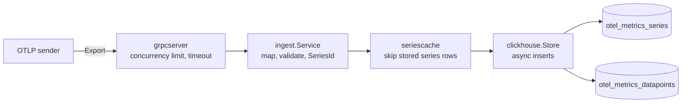
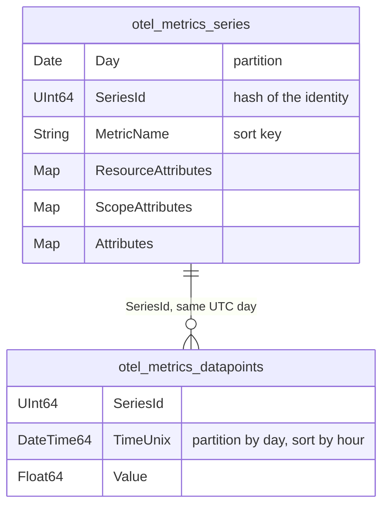
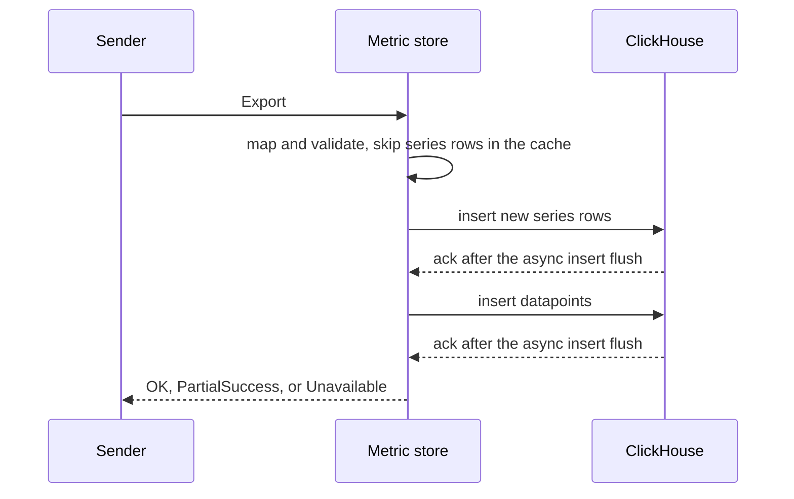

# OTLP metric store (Go)

A gRPC service that receives OTLP metrics (Gauge and Sum) and stores them in ClickHouse as two tables:
a **series** lookup table with one series row per series per day, and a thin **datapoints** table that references it by `SeriesId`.
Terms used in the code and these docs are defined in [`GLOSSARY.md`](GLOSSARY.md).

## Quick start

Only Docker is needed; Go runs in a container too.

```shell
docker compose up -d --build     # ClickHouse + the metric store + telemetrygen (a gauge "gen" for 5 minutes)
docker compose exec -T clickhouse clickhouse-client --password metricstore --multiquery --format PrettyCompact < queries.sql
docker compose up -d telemetrygen                             # 5 more minutes of data, if queries come back empty
docker compose run --rm go go test ./...                      # unit tests
docker compose run --rm go go test -tags integration ./...    # integration tests (ClickHouse via testcontainers)
docker compose down -v
```

With Go 1.26 installed, plain `go build ./...` and `go test ./...` work too. `go run ./...` needs a
ClickHouse; to use the stack's, stop the containerised service first, since both use ports 4317 and 9464:

```shell
docker compose stop metric-store
CLICKHOUSE_PASSWORD=metricstore OTEL_METRICS_EXPORTER=prometheus go run ./...
```

telemetrygen sends to the container, not to `go run`. The `Makefile` has shortcuts for the same commands
(`make up`, `make test-all`, `make down`), plus `make vet`, `make lint` (staticcheck)
and `make deadcode` (fails on any function unreachable from `main`, e.g. code only tests use).
`make check` runs all of them plus a format check, like CI (`.github/workflows/ci.yml`).

While the stack runs: `docker compose logs metric-store` shows the logs, `curl localhost:9464/metrics` the
self-metrics.

ClickHouse creates the tables from [`deploy/clickhouse/schema.sql`](deploy/clickhouse/schema.sql) on first
start; the service only inserts.

## Scope

Built: the lookup table, the reference between the tables, time-bounded storage with no full scans,
throughput, validation, self-metrics and production basics (config, health, graceful shutdown).
Larger hardening is listed under [Next steps](#next-steps) instead of built.

## Design



```
ExportMetricsServiceRequest
 └─ ResourceMetrics       resource attributes (service.name, host.name, …)
     └─ ScopeMetrics      scope (name, version, attributes)
         └─ Metric        name, unit, type (Gauge | Sum)
             └─ Datapoint attributes, time, value

identity (resource + scope + metric + datapoint attributes) → hash → SeriesId
  → one row per series per UTC day in otel_metrics_series
each datapoint → (SeriesId, StartTimeUnix, TimeUnix, Value, Flags) in otel_metrics_datapoints
```

### `SeriesId`: the reference

- xxhash64 of a canonical encoding of the identity: a version byte, fixed field order, length-prefixed
  strings, sorted map keys. `TestSeriesIdGolden` pins it.
- Computed, not assigned: ClickHouse has no auto-increment, and every instance computes the same
  `SeriesId` with no coordination or lookup.
- Attributes change ⇒ new `SeriesId` ⇒ new series. The old one stops receiving datapoints and ages out.
- Not part of the identity: description and dropped-attribute counts, so a typo fix doesn't split history.
- Each OTLP level is hashed once and the hash state reused below it, so cost is linear in request size.

### Tables



| | `otel_metrics_series` | `otel_metrics_datapoints` |
|---|---|---|
| Engine | `ReplacingMergeTree` (duplicates collapse) | `MergeTree` |
| Partition | `Day` | `toDate(TimeUnix, 'UTC')` |
| Sort key | `(MetricName, SeriesId)` | `(toStartOfHour(TimeUnix), SeriesId, toUnixTimestamp64Nano(TimeUnix))` |
| Retention | TTL 30 days, whole partitions dropped | same |

- **Series rows per day**: every datapoint finds its series row in the same day, a "last 2 hours" query reads
  one or two days of series rows, and series rows expire with the data.
- **Hour first in the datapoints key**: time is the only mandatory filter, so a time-only query uses the
  primary index instead of reading the whole day. The last column is `toUnixTimestamp64Nano(TimeUnix)`
  because with plain `TimeUnix` ClickHouse 26.2 didn't derive the hour bound (9/9 granules read instead of 1/9);
  `TestTimeOnlyQueryPrunes` guards this.
- Codecs: `Delta` for timestamps, `Gorilla` for values, `ZSTD` for attributes. `Delta` measured smaller
  than `DoubleDelta` here (8.6M datapoints at 10 s intervals: 30 vs 35 MiB with millisecond jitter, 105 vs
  112 KiB without).
- No skip indexes on the series table, unlike the scaffold's bloom filters on every attribute map: it holds
  one row per series per day, so a query filtering only by attributes reads that day's series rows, which
  is small at the assumed low cardinality.

### Write path (one `Export`)



1. **Map and validate.** Bad datapoints are rejected with a reason: `unsupported_metric_type` (histograms,
   summaries), `missing_metric_name`, `invalid_temporality` (a Sum that is not delta or cumulative),
   `invalid_timestamp` (0, older than retention, more than 1h ahead), `missing_value`,
   `series_limit_exceeded` (see below).
2. **Skip stored series rows** using the series cache, an in-memory LRU of `(Day, SeriesId)` (default 100k
   entries).
3. **Insert new series rows, then datapoints.** A datapoint never references a missing series row. Series
   rows enter the cache only after their insert succeeded.
4. **Reply.** All good: empty response. Some rejected: OTLP `PartialSuccess` with counts by reason; the rest
   is stored. Store failure (ClickHouse did not take the rows): `Unavailable` (`DeadlineExceeded` when
   `-exportTimeout` fires during an insert), which senders retry (always; see below). The driver error is
   logged, never sent.

**Series Limit.** Every series row repeats its resource and scope attributes, so one small, compressible
request (a 1 KB resource attribute × 10,000 one-datapoint metrics) would create 10 MB of series rows.
`-maxSeriesBytesPerRequest` (default 16 MiB, the same as the request limit) is the series limit: the most
bytes of new series rows one Export Request may create. A datapoint that needs a new series row beyond it is
rejected as `series_limit_exceeded`, while later datapoints of series already accepted in the request are
kept. Rows the series cache already holds create nothing and don't count, so a sender whose series are
stored is never rejected, as long as its active series rows fit in `-seriesCacheSize`; a sender over the
limit loses the excess of its first request, and the next request finds those series stored. Sizes are
summed once per OTLP level, like the hashes, plus 64 bytes per row for the fixed columns, so the limit also
bounds the row count.

**Why every store failure is retryable.** A non-retryable code (`InvalidArgument`) would make the sender drop
the request, which is right only when this request's own rows cause the error. No ClickHouse error here
qualifies:
- The mapper validates every value and the rows have fixed Go types, so a driver conversion error or
  `TYPE_MISMATCH` means the schema changed under the service. That fails every request, and retrying
  keeps the data in senders' queues until an operator fixes it, where dropping would lose it.
- Async inserts merge concurrent requests into one flush, and an error at flush time fails every request
  in it: a constraint violated by one sender's rows also fails another sender's valid rows
  (`TestAsyncInsertErrorIsShared`). Retried, the valid request lands in a later flush; dropped, it is lost.

A request that can never be stored is retried until the sender's retry limit (the Collector's default is
5 minutes of backoff) and then dropped by the sender.

Inserts use ClickHouse async inserts with `wait_for_async_insert=1`: ClickHouse batches small inserts into
large parts, and we reply only after it has the data. Delivery is at-least-once.

Series cache behaviour to know:
- At 00:00 UTC every active series misses (the key includes the day), so each instance writes one series
  row per active series in the first seconds of the day. Fine at low cardinality; it is the price of
  series rows that expire with their data.
- If active series rows outnumber `-seriesCacheSize`, the LRU evicts rows still in use, and they are
  written again on every request and count against the series limit again, so a large request can be
  rejected as `series_limit_exceeded` over and over. `metricstore.series.cache.evictions` rising steadily
  is the signal to raise the size.

### Throughput

An insert holds its ClickHouse connection until ClickHouse flushes the async insert buffer (50–200 ms), so
one instance handles about `connections / 0.2 s` inserts per second, whatever the request size. Export
calls are therefore limited by `-maxConcurrentExports` (default 64), and the connection pool is sized from
it: one connection per Export (it inserts series, then datapoints, never both at once) plus one for the
health check. A call over the limit fails at once with `Unavailable`, which senders retry with backoff,
instead of waiting for a connection.

Measured on a laptop (Apple M3 Pro, ClickHouse 26.2 in Docker), 100 datapoints per request, defaults:

| Concurrent senders | Stored | Latency p50 / p99 | Refused |
|---|---|---|---|
| 8 | 44 req/s (4,400 datapoints/s) | 187 / 199 ms | 0 |
| 64 | 304 req/s (30,400 datapoints/s) | 222 / 241 ms | 0 |
| 256 | 308 req/s (30,800 datapoints/s) | — | the rest, in ~5 ms each |

Without the limit, 256 senders queue for connections: with a 10-connection pool they got 54 req/s at 5 s
p50 latency, and some requests failed after a 5–10 s wait. Since the flush wait dominates, larger requests
give more datapoints per second at roughly the same request rate (43 req/s at both 100 and 2,000
datapoints per request, with 10 connections). More throughput per instance
means a larger `-maxConcurrentExports` (ClickHouse must accept the connections) or the in-process batcher
under [Next steps](#next-steps); more instances scale linearly, since they share nothing.

## Decisions and alternatives

| Decision | Alternative considered | Why not |
|---|---|---|
| `SeriesId` computed in the service | Insert full rows into a Null table, split by materialized views | Sends the whole series identity with every datapoint, and nothing can skip stored series rows |
| A series row per day | One series table with first/last seen | Series rows would not expire with their data, and finding a time range's series needs a range filter |
| Hour first in the datapoints sort key | `(SeriesId, TimeUnix)` with day partitions only | A time-only query would read the whole day |
| Server-side async inserts, acknowledged after flush | In-process batching across requests | Simpler and stateless, at the cost of one connection per in-flight Export (see Throughput) |
| 64-bit xxhash | 128-bit hash, or a collision check on cache miss | ≈3·10⁻⁶ collision probability at 10M series did not justify twice the key size |
| Series Limit counts only rows not in this instance's series cache | Count every series row the request produces | A sender over the limit would lose the same datapoints on every request, since partial success is not retried |
| Every store failure is retryable (`Unavailable`) | Mark data-caused ClickHouse errors permanent (`InvalidArgument`) | Async inserts share a flush, so one sender's bad rows fail others' valid rows, which would then be dropped (`TestAsyncInsertErrorIsShared`); schema drift would drop everything |

## Querying

No read API; [`queries.sql`](queries.sql) has examples. Bound the datapoints by `TimeUnix`, the series by
`Day`, and deduplicate series (`GROUP BY SeriesId` + `any()`) before joining. The `Day` range must cover the
`TimeUnix` range, including datapoints stamped up to an hour in the future:

```sql
WITH series AS (
    SELECT SeriesId, any(ResourceAttributes['host.name']) AS host
    FROM otel_metrics_series
    WHERE MetricName = 'gen'
      AND Day BETWEEN toDate(now() - INTERVAL 2 HOUR, 'UTC') AND toDate(now() + INTERVAL 1 HOUR, 'UTC')
    GROUP BY SeriesId
)
SELECT host, count() AS datapoints, avg(Value) AS avg_value
FROM otel_metrics_datapoints
INNER JOIN series USING SeriesId
WHERE TimeUnix >= now() - INTERVAL 2 HOUR
  AND SeriesId IN (SELECT SeriesId FROM series)
GROUP BY host
```

## Operations

Configuration (default < env < flag):

| Flag | Env | Default |
|---|---|---|
| `-listenAddr` | `METRICSTORE_LISTEN_ADDR` | `localhost:4317` |
| `-maxReceiveMessageSize` | `METRICSTORE_MAX_RECEIVE_MESSAGE_SIZE` | `16777216` |
| `-maxSeriesBytesPerRequest` | `METRICSTORE_MAX_SERIES_BYTES_PER_REQUEST` | `16777216` |
| `-clickhouseAddr` | `CLICKHOUSE_ADDR` | `localhost:9000` |
| `-clickhouseDatabase` | `CLICKHOUSE_DATABASE` | `default` |
| `-clickhouseUsername` | `CLICKHOUSE_USERNAME` | `default` |
| — | `CLICKHOUSE_PASSWORD` (env only) | empty |
| `-maxConcurrentExports` | `METRICSTORE_MAX_CONCURRENT_EXPORTS` | `64` (ClickHouse pool: this + 1) |
| `-exportTimeout` | `METRICSTORE_EXPORT_TIMEOUT` | `10s` |
| `-retentionDays` | `METRICSTORE_RETENTION_DAYS` | `30` |
| `-seriesCacheSize` | `METRICSTORE_SERIES_CACHE_SIZE` | `100000` |
| `-shutdownTimeout` | `METRICSTORE_SHUTDOWN_TIMEOUT` | `30s` |
| `-shutdownDelay` | `METRICSTORE_SHUTDOWN_DELAY` | `5s` |
| `-logLevel` | `METRICSTORE_LOG_LEVEL` | `info` |

`-maxReceiveMessageSize` defaults to 16 MiB, below the 64 MiB the OTLP specification recommends: the 64
Exports waiting on ClickHouse then hold at most ~1 GiB of request bytes (several times that once decoded)
instead of ~4 GiB, and senders' default requests are far smaller. This is not a bound on total memory:
a call over `-maxConcurrentExports` is still received and decoded before it is refused, then freed at once,
and nothing limits concurrent streams or connections. A larger request gets `RESOURCE_EXHAUSTED`, which
senders do not retry, so raise the limit if senders send larger requests.

Self-metrics (`metricstore.*`): `datapoints.received`, `datapoints.stored`, `datapoints.rejected{reason}`,
`exports.throttled`, `series.written`, `series.cache.hits` / `misses` / `evictions`,
`insert.duration{table}`, `insert.errors{table}`, plus `otelgrpc` RPC metrics. A counter appears on
`/metrics` only after its first increment. The `series.*` counters count series rows, and the duration
histograms (`insert.duration`, `rpc.server.call.duration`) use buckets from 5 ms to 10 s. `received` and
`rejected` count every attempt, so a request the sender retries after a store failure is counted again;
`stored` counts only what was stored. The only traces are `otelgrpc` server spans, one per RPC.

Logs are JSON lines on stderr, filtered by `-logLevel`; `debug` adds one line per `Export`. Metrics,
traces and logs are also exported through OpenTelemetry when the standard `OTEL_METRICS_EXPORTER`,
`OTEL_TRACES_EXPORTER` or `OTEL_LOGS_EXPORTER` is set (`otlp`, `prometheus` for metrics, `console`), and
not at all when it is unset. `OTEL_SERVICE_NAME` and `OTEL_RESOURCE_ATTRIBUTES` override the resource.

Startup fails fast if ClickHouse is unreachable. Health (`grpc.health.v1`) pings ClickHouse every 5 s:
`SERVING` while it answers, `NOT_SERVING` while it does not, so a readiness probe takes the instance out of
the load balancer.
On SIGINT/SIGTERM: health → `NOT_SERVING` while still serving for `-shutdownDelay` (so probes see it
before connections are refused), end open health Watch streams (with `Unavailable`), graceful drain
(hard stop after `-shutdownTimeout`), close ClickHouse, flush telemetry. A second signal during shutdown
kills the process.

Each Export runs for at most `-exportTimeout`, whatever deadline the sender set. A panic in an Export is
logged with its stack and returned as `Internal` instead of crashing the process.

## Code layout

```
cmd/otlp-metric-store/   wiring, OTel SDK setup, signal handling
internal/ingest/         Export service, OTLP → rows mapper, SeriesId; declares the Store interface
internal/clickhouse/     Store (implements ingest.Store): inserts only
internal/seriescache/    Store wrapper that skips already-stored series rows via an LRU (implements ingest.Store)
internal/grpcserver/     gRPC server, graceful stop
internal/config/         flags + env → Config
deploy/clickhouse/       schema.sql: the tables, run by ClickHouse on first start
```

`clickhouse` and `seriescache` import `ingest`, never the reverse. Tests in `internal/` are black-box
`_test` packages; the service and the series cache are tested with fake `Store` implementations,
ClickHouse behaviour by integration tests.

## Limitations

- Only Gauge and Sum; other types are rejected and counted.
- No auth or TLS; single-node ClickHouse.
- At-least-once: a lost reply means a retried request is stored twice.
- 64-bit `SeriesId` collisions are not detected (≈3·10⁻⁶ at 10M series).
- Int values stored as Float64 (precision loss above 2⁵³); attribute values stored as strings.
- Attribute types are not part of the series identity: int `42` and string `"42"` (or bytes and their
  base64 string) give the same stored value and the same `SeriesId`.
- Every store failure maps to `Unavailable`, or `DeadlineExceeded` when `-exportTimeout` fires during an
  insert; both are retryable (see [Write path](#write-path-one-export)), so a request that can never be
  stored is retried until the sender gives up.
- The series limit trusts the series cache: a row evicted between mapping and insert is written
  without counting against the limit. Each instance has its own cache, so a row another instance stored
  counts as new.
- Right after a start and at 00:00 UTC the series cache is cold, so a single request with more than
  `-maxSeriesBytesPerRequest` (16 MiB) of new series rows loses the excess datapoints. Default Collector
  Export Requests (8,192 datapoints, the batch processor's default) stay under it with normal resources;
  raise the limit if senders send larger requests.
- `wait_for_async_insert` adds up to ~200 ms per request and bounds throughput per connection
  (see [Throughput](#throughput)).
- Exemplars on datapoints are not stored.
- Retention is counted in whole UTC days, like the TTL: a datapoint whose day the TTL has already dropped
  is rejected even if it is less than `-retentionDays` × 24 h old.

## Next steps

- Histogram, ExponentialHistogram and Summary: own datapoint tables keyed by `SeriesId`.
- An in-process batcher that merges rows from many Exports into one insert, so connections stop
  bounding throughput.
- Schema migrations as a deploy step (e.g. golang-migrate): `schema.sql` only creates the tables, so
  changing them or the TTL needs an `ALTER TABLE`. `-retentionDays` must match the TTL by hand.
- Over the series limit, store the series rows that fit and fail the request with `Unavailable` instead
  of rejecting the excess: the retry finds those rows cached and gets further, so nothing is lost and no
  datapoint is stored twice.
- Collision detection on cache miss; TLS and auth.
